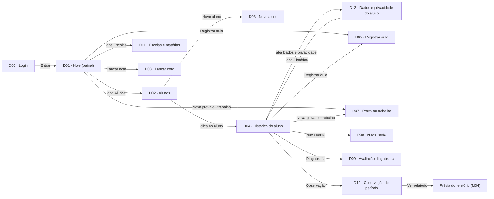
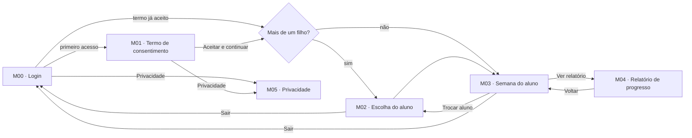
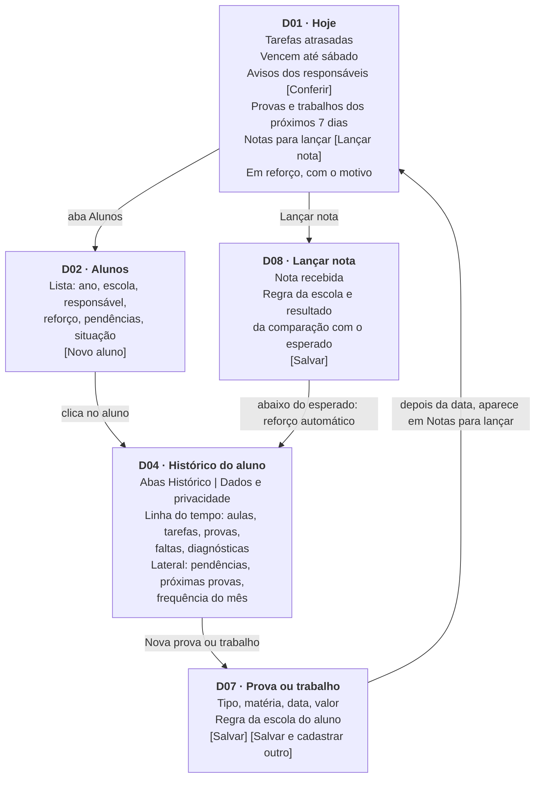
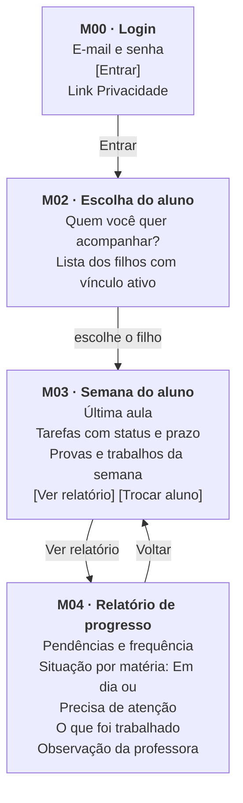
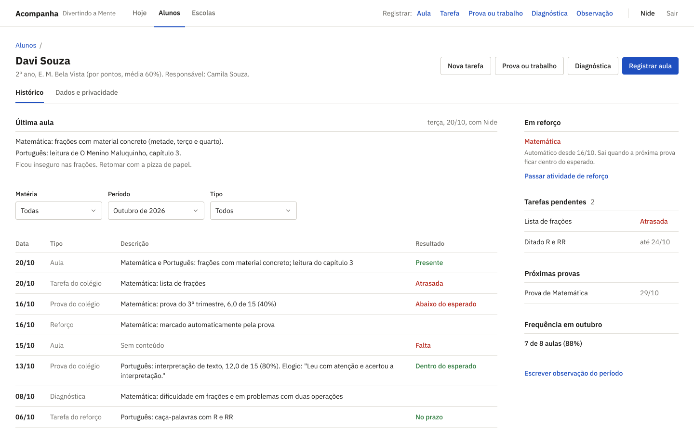
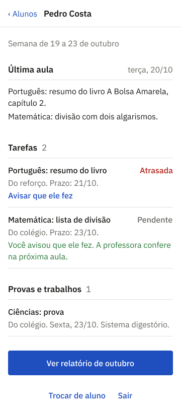
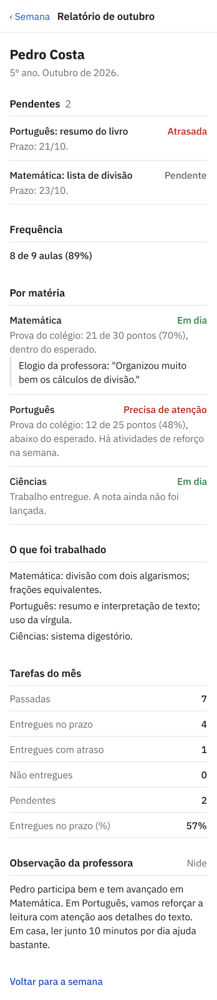
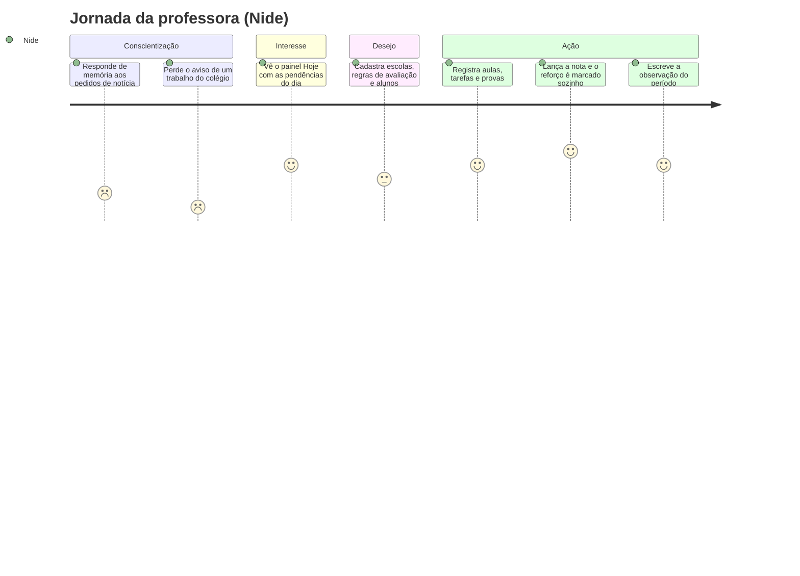
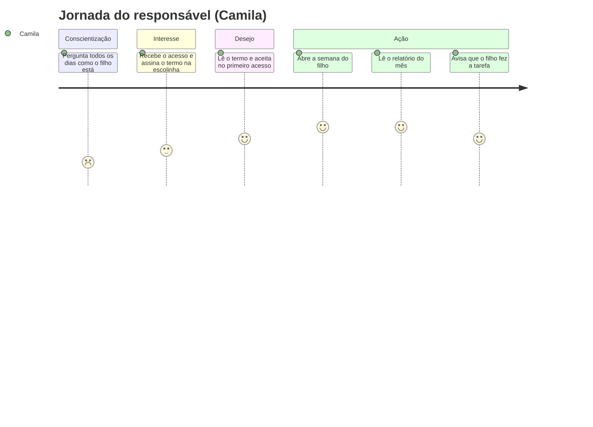

# Projeto de interface

Pré-requisitos: <a href="02-Especificacao.md"> Especificação do projeto</a>

Visão geral da interação do usuário pelas telas do sistema e protótipo interativo das telas com as funcionalidades que fazem parte do sistema (wireframes).

O sistema tem duas frentes, desenhadas para o equipamento que cada perfil já usa (R03): a da professora, no computador da escolinha, e a do responsável, no celular. A frente da professora concentra o registro (aulas, tarefas, provas, notas, diagnósticas e observações) e abre em um painel com o que pede ação no dia. A frente do responsável é só de consulta e abre direto na semana do filho, com rótulos simples como "Em dia" e "Precisa de atenção" (HU12), para atender quem tem pouca familiaridade com tecnologia.

## User flow

Fluxo de usuário (user flow) é uma técnica que permite ao desenvolvedor mapear todo o fluxo de navegação do usuário na aplicação. Essa técnica serve para alinhar os caminhos e as possíveis ações que o usuário pode realizar junto com os membros da equipe.

Os fluxos abaixo seguem a navegação do [protótipo](#protótipo-interativo). Os códigos (D00, M00 etc.) são os das telas.

### Professora

Todas as telas da professora têm o mesmo topo, com as abas Hoje, Alunos e Escolas e os atalhos de registro (Aula, Tarefa, Prova ou trabalho, Diagnóstica, Observação). Por isso, qualquer tela de registro pode ser aberta de qualquer ponto do sistema. Nas telas de registro, Salvar e Cancelar voltam para a tela de origem.

### Responsável

> **Links úteis**:
> - [User flow: o quê é e como fazer?](https://medium.com/7bits/fluxo-de-usu%C3%A1rio-user-flow-o-que-%C3%A9-como-fazer-79d965872534)
> - [User flow vs site maps](http://designr.com.br/sitemap-e-user-flow-quais-as-diferencas-e-quando-usar-cada-um/)
> - [Top 25 user flow tools & templates for smooth](https://www.mockplus.com/blog/post/user-flow-tools)

### Diagrama de fluxo

O diagrama apresenta o estudo do fluxo de interação do usuário com o sistema interativo, muitas vezes sem a necessidade de desenhar o design das telas da interface. Isso permite que o design das interações seja bem planejado e tenha impacto na qualidade do design do wireframe interativo que será desenvolvido logo em seguida.

O diagrama de fluxo pode ser desenvolvido com “boxes” que possuem, internamente, a indicação dos principais elementos de interface — tais como menus e acessos — e funcionalidades, como editar, pesquisar, filtrar e configurar, além da conexão entre esses boxes a partir do processo de interação.

Os diagramas abaixo mostram os principais elementos das telas mais usadas e as ações que levam de uma à outra.

**Professora: do painel ao registro de nota**

**Responsável: consulta do progresso**

> **Links úteis**:
> - [Como criar um diagrama de fluxo de usuário](https://www.lucidchart.com/blog/how-to-make-a-user-flow-diagram)
> - [Fluxograma online: seis sites para fazer gráfico sem instalar nada](https://www.techtudo.com.br/listas/2019/03/fluxograma-online-seis-sites-para-fazer-grafico-sem-instalar-nada.ghtml)

## Wireframes

São protótipos usados no design de interface para sugerir a estrutura de um site web e seu relacionamento entre suas páginas. Um wireframe web é uma ilustração que mostra o layout dos elementos fundamentais na interface.

As imagens abaixo são das telas principais de cada frente, tiradas do [protótipo](#protótipo-interativo). As demais telas estão no Figma, com os links na tabela do protótipo.

**D01 · Hoje (painel da professora, desktop).** Duas colunas: à esquerda o que está vencendo ou atrasado e os avisos dos responsáveis; à direita provas e trabalhos próximos, notas para lançar e alunos em reforço. Datas vencidas e matérias em reforço aparecem em vermelho.

")

**D04 · Histórico do aluno (desktop).** Linha do tempo do aluno à esquerda e, na lateral, pendências, próximas provas e frequência do mês.

**M03 · Semana do aluno e M04 · Relatório de progresso (celular).** Uma coluna só, com blocos curtos e rótulos em linguagem simples.

 
> **Links úteis**:
> - [Protótipos: baixa, média ou alta fidelidade?](https://medium.com/ladies-that-ux-br/prot%C3%B3tipos-baixa-m%C3%A9dia-ou-alta-fidelidade-71d897559135)
> - [Protótipos vs wireframes](https://www.nngroup.com/videos/prototypes-vs-wireframes-ux-projects/)
> - [Ferramentas de wireframes](https://rockcontent.com/blog/wireframes/)
> - [MarvelApp](https://marvelapp.com/developers/documentation/tutorials/)
> - [Figma](https://www.figma.com/)
> - [Adobe XD](https://www.adobe.com/br/products/xd.html#scroll)
> - [Axure](https://www.axure.com/edu) (Licença Educacional)
> - [InvisionApp](https://www.invisionapp.com/) (Licença Educacional)

## Protótipo interativo

O protótipo está no Figma: [Acompanha – Protótipo](https://www.figma.com/design/KjtSsah133BDvt0Nvc8JpL/Acompanha---Prot%C3%B3tipo?node-id=11-709).

O sistema tem duas frentes:

- **Professora (desktop, telas D00 a D12):** registra aulas, tarefas, provas e trabalhos, notas, avaliações diagnósticas e observações, e cadastra alunos e escolas. Todas as telas usam o mesmo topo (componente `Topo/Professora`), com as abas Hoje, Alunos e Escolas e os atalhos de registro (Aula, Tarefa, Prova ou trabalho, Diagnóstica, Observação).
- **Responsável (mobile, telas M00 a M05):** aceita o termo de consentimento, escolhe o filho e consulta a semana e o relatório de progresso.

Além das telas, a página do Figma tem dois quadros de referência para o desenvolvimento:

- **Componentes:** o topo da professora.
- **Componentes interativos:** campos (seleção, texto, texto longo), caixas de seleção, grupos de rádio usados em cada tela, botões (primário, secundário, perigo), linhas de lista das telas D01, D02, D04, D10, D11 e M02 e o aviso de tarefa.

O código de cada tela (D00, M00 etc.) é o mesmo usado no nome do quadro no Figma.

| **Código** | **Tela** | **Perfil** | **Figma** |
| --- | --- | --- | --- |
| D00 | Login (professora) | Professora | [abrir](https://www.figma.com/design/KjtSsah133BDvt0Nvc8JpL/Acompanha---Prot%C3%B3tipo?node-id=11-759) |
| D01 | Hoje (painel) | Professora | [abrir](https://www.figma.com/design/KjtSsah133BDvt0Nvc8JpL/Acompanha---Prot%C3%B3tipo?node-id=11-780) |
| D02 | Alunos | Professora | [abrir](https://www.figma.com/design/KjtSsah133BDvt0Nvc8JpL/Acompanha---Prot%C3%B3tipo?node-id=11-968) |
| D03 | Novo aluno | Professora | [abrir](https://www.figma.com/design/KjtSsah133BDvt0Nvc8JpL/Acompanha---Prot%C3%B3tipo?node-id=12-791) |
| D04 | Histórico do aluno | Professora | [abrir](https://www.figma.com/design/KjtSsah133BDvt0Nvc8JpL/Acompanha---Prot%C3%B3tipo?node-id=12-955) |
| D05 | Registrar aula | Professora | [abrir](https://www.figma.com/design/KjtSsah133BDvt0Nvc8JpL/Acompanha---Prot%C3%B3tipo?node-id=12-1147) |
| D06 | Nova tarefa | Professora | [abrir](https://www.figma.com/design/KjtSsah133BDvt0Nvc8JpL/Acompanha---Prot%C3%B3tipo?node-id=12-1280) |
| D07 | Prova ou trabalho | Professora | [abrir](https://www.figma.com/design/KjtSsah133BDvt0Nvc8JpL/Acompanha---Prot%C3%B3tipo?node-id=12-1387) |
| D08 | Lançar nota | Professora | [abrir](https://www.figma.com/design/KjtSsah133BDvt0Nvc8JpL/Acompanha---Prot%C3%B3tipo?node-id=12-1480) |
| D09 | Avaliação diagnóstica | Professora | [abrir](https://www.figma.com/design/KjtSsah133BDvt0Nvc8JpL/Acompanha---Prot%C3%B3tipo?node-id=14-1096) |
| D10 | Observação do período | Professora | [abrir](https://www.figma.com/design/KjtSsah133BDvt0Nvc8JpL/Acompanha---Prot%C3%B3tipo?node-id=14-1186) |
| D11 | Escolas e matérias | Professora | [abrir](https://www.figma.com/design/KjtSsah133BDvt0Nvc8JpL/Acompanha---Prot%C3%B3tipo?node-id=14-1298) |
| D12 | Dados e privacidade do aluno | Professora | [abrir](https://www.figma.com/design/KjtSsah133BDvt0Nvc8JpL/Acompanha---Prot%C3%B3tipo?node-id=14-1426) |
| M00 | Login (responsável) | Responsável | [abrir](https://www.figma.com/design/KjtSsah133BDvt0Nvc8JpL/Acompanha---Prot%C3%B3tipo?node-id=14-1578) |
| M01 | Termo de consentimento | Responsável | [abrir](https://www.figma.com/design/KjtSsah133BDvt0Nvc8JpL/Acompanha---Prot%C3%B3tipo?node-id=14-1595) |
| M02 | Escolha do aluno | Responsável | [abrir](https://www.figma.com/design/KjtSsah133BDvt0Nvc8JpL/Acompanha---Prot%C3%B3tipo?node-id=14-1623) |
| M03 | Semana do aluno | Responsável | [abrir](https://www.figma.com/design/KjtSsah133BDvt0Nvc8JpL/Acompanha---Prot%C3%B3tipo?node-id=14-1644) |
| M04 | Relatório de progresso | Responsável | [abrir](https://www.figma.com/design/KjtSsah133BDvt0Nvc8JpL/Acompanha---Prot%C3%B3tipo?node-id=14-1687) |
| M05 | Privacidade | Responsável | [abrir](https://www.figma.com/design/KjtSsah133BDvt0Nvc8JpL/Acompanha---Prot%C3%B3tipo?node-id=14-1770) |

## Jornada do usuário

A jornada do usuário descreve, em alto nível de detalhes, as etapas que diferentes perfis de usuários realizam para concluir uma tarefa específica na aplicação. Essa técnica ajuda a identificar pontos fortes e oportunidades de melhoria na experiência.  

As jornadas abaixo seguem as fases do modelo AIDA (conscientização, interesse, desejo e ação) e foram montadas a partir das <a href="02-Especificacao.md#personas">personas</a>: uma para a professora (P1, Nide) e outra para o responsável (P3, Camila). As emoções são as esperadas a partir das entrevistas, numa escala de 1 (frustração) a 5 (satisfação).

### Professora (Nide)

| Fase | Etapa | Ações da professora | Pontos de contato | Emoções e percepções |
| --- | --- | --- | --- | --- |
| Conscientização | Situação atual | Acompanha os alunos sem registro e responde aos pais de memória, quase todos os dias. | Conversa presencial com as famílias, caderno de cada aluno | Sobrecarga; frustração quando uma informação se perde, como o trabalho de História que não foi registrado |
| Interesse | Primeiro contato | Entra no sistema e vê, no painel Hoje, tarefas atrasadas, provas próximas, notas para lançar e alunos em reforço. | D00, D01 | Curiosidade: é o que ela disse que queria ver "ao abrir o sistema" |
| Desejo | Preparação | Cadastra as escolas com a regra de avaliação de cada uma, as matérias e os alunos com o responsável e o consentimento. | D11, D03 | Esforço inicial, compensado pela expectativa de não depender mais da memória |
| Ação | Uso no dia a dia | Registra a aula, passa tarefas, cadastra provas e trabalhos, lança notas, confere os avisos dos responsáveis e escreve a observação do período. | D01, D05, D06, D07, D08, D10 | Alívio: o reforço é marcado sozinho e o retorno às famílias passa a ter registro |

### Responsável (Camila)

| Fase | Etapa | Ações da responsável | Pontos de contato | Emoções e percepções |
| --- | --- | --- | --- | --- |
| Conscientização | Situação atual | Pergunta à professora, todos os dias, como o filho está e se fez as tarefas. | Conversa presencial na escolinha | Insegurança: depende do que a professora lembra no momento |
| Interesse | Cadastro | Recebe da professora o e-mail de acesso e assina o termo de consentimento na escolinha. | Escolinha, D03 (feito pela professora) | Curiosidade sobre o que vai poder ver |
| Desejo | Primeiro acesso | Entra pelo celular, lê quais dados são coletados, para quê e por quanto tempo, e aceita o termo. | M00, M01, M05 | Segurança: sabe o que é registrado e como pedir a exclusão |
| Ação | Consulta | Abre a semana do filho, vê a última aula, as tarefas e as provas, lê o relatório do mês e avisa quando o filho faz a tarefa. | M03, M04 | Tranquilidade: sabe como o filho está sem precisar perguntar |

> **Links úteis**:
> - [Dicas sobre como mapear uma jornada do usuário](https://www.userinterviews.com/blog/best-customer-journey-map-templates-examples)
> - [Jornada do usuário versus user flow](https://www.nngroup.com/articles/user-journeys-vs-user-flows/)

## Interface do sistema

As telas abaixo são as do [protótipo](#protótipo-interativo). As telas ligadas aos processos BPMN estão descritas junto com o processo, conforme a <a href="04-Modelagem-processos-negocio.md"> Modelagem dos processos de negócio</a>.

### Tela principal do sistema

#### D01 · Hoje (painel)

Primeira tela da professora depois do login. Reúne o que pede ação no dia: tarefas atrasadas, tarefas que vencem até sábado, avisos dos responsáveis (com o botão Conferir), provas e trabalhos dos próximos 7 dias, notas para lançar e alunos em reforço, com o motivo. Pelos botões do topo a professora registra uma aula ou uma nova prova ou trabalho.

> Tela no Figma: [D01 · Hoje (painel)](https://www.figma.com/design/KjtSsah133BDvt0Nvc8JpL/Acompanha---Prot%C3%B3tipo?node-id=11-780)

### Telas dos processos BPMN

#### Processo 1 – Provas e trabalhos do colégio

**D07 · Prova ou trabalho.** A professora cadastra a prova ou trabalho do colégio (tipo, matéria, data, valor). A tela mostra a regra da escola do aluno (por exemplo, "avalia por pontos, com média de 70%") e avisa que a nota pode ser lançada depois. A prova cadastrada passa a aparecer no painel (D01) e na semana do responsável (M03).

> Tela no Figma: [D07 · Prova ou trabalho](https://www.figma.com/design/KjtSsah133BDvt0Nvc8JpL/Acompanha---Prot%C3%B3tipo?node-id=12-1387)

**D08 · Lançar nota.** A professora lança a nota recebida. A tela mostra a regra da escola (pontos ou conceito, e o mínimo esperado) e o resultado da comparação, como "Dentro do esperado". Se a nota não vier, depois de um prazo a prova pode ser marcada como sem nota.

> Tela no Figma: [D08 · Lançar nota](https://www.figma.com/design/KjtSsah133BDvt0Nvc8JpL/Acompanha---Prot%C3%B3tipo?node-id=12-1480)

**D04 · Histórico do aluno.** Linha do tempo do aluno com aulas, tarefas, provas, faltas e diagnósticas. Mostra o resultado de cada prova, o elogio registrado e o reforço marcado automaticamente quando a prova fica abaixo do esperado ("Sai quando a próxima prova ficar dentro do esperado"). Na lateral: tarefas pendentes, próximas provas e frequência do mês.

> Tela no Figma: [D04 · Histórico do aluno](https://www.figma.com/design/KjtSsah133BDvt0Nvc8JpL/Acompanha---Prot%C3%B3tipo?node-id=12-955)

**D06 · Nova tarefa.** Usada para passar as atividades de reforço. Avisa quando o aluno está em reforço na matéria e explica os status da tarefa: pendente, entregue no prazo, entregue com atraso e não entregue. Só a professora muda o status; o aviso do responsável aparece em Hoje (D01).

> Tela no Figma: [D06 · Nova tarefa](https://www.figma.com/design/KjtSsah133BDvt0Nvc8JpL/Acompanha---Prot%C3%B3tipo?node-id=12-1280)

#### Processo 2 – Consulta do progresso pelo responsável

**M00 · Login (responsável).** Entrada do responsável por e-mail e senha. Quem esquece a senha pede à professora.

> Tela no Figma: [M00 · Login (responsável)](https://www.figma.com/design/KjtSsah133BDvt0Nvc8JpL/Acompanha---Prot%C3%B3tipo?node-id=14-1578)

**M02 · Escolha do aluno.** Para quem tem mais de um filho na escolinha. Lista só os alunos com vínculo ativo com o responsável.

> Tela no Figma: [M02 · Escolha do aluno](https://www.figma.com/design/KjtSsah133BDvt0Nvc8JpL/Acompanha---Prot%C3%B3tipo?node-id=14-1623)

**M03 · Semana do aluno.** O que o sistema mostra primeiro: última aula, tarefas (com status e prazo) e provas e trabalhos da semana. Dá acesso ao relatório do mês.

> Tela no Figma: [M03 · Semana do aluno](https://www.figma.com/design/KjtSsah133BDvt0Nvc8JpL/Acompanha---Prot%C3%B3tipo?node-id=14-1644)

**M04 · Relatório de progresso.** Relatório do mês ou do bimestre: pendências, frequência, situação por matéria ("Em dia" ou "Precisa de atenção", com a nota e a comparação com o esperado), o que foi trabalhado, números das tarefas do mês e a observação da professora.

> Tela no Figma: [M04 · Relatório de progresso](https://www.figma.com/design/KjtSsah133BDvt0Nvc8JpL/Acompanha---Prot%C3%B3tipo?node-id=14-1687)

**D10 · Observação do período.** A professora escreve a observação pedagógica do período, que aparece no relatório (M04). A tela mostra o resumo do mês do aluno para apoiar a escrita. Se ficar vazia, o relatório mostra "Sem observação neste período".

> Tela no Figma: [D10 · Observação do período](https://www.figma.com/design/KjtSsah133BDvt0Nvc8JpL/Acompanha---Prot%C3%B3tipo?node-id=14-1186)

### Demais telas do sistema

**D00 · Login (professora).** Entrada da professora. Quem esquece a senha fala com a Nide.

> Tela no Figma: [D00 · Login (professora)](https://www.figma.com/design/KjtSsah133BDvt0Nvc8JpL/Acompanha---Prot%C3%B3tipo?node-id=11-759)

**D02 · Alunos.** Lista dos alunos ativos com ano, escola, responsável, reforço, pendências e situação.

> Tela no Figma: [D02 · Alunos](https://www.figma.com/design/KjtSsah133BDvt0Nvc8JpL/Acompanha---Prot%C3%B3tipo?node-id=11-968)

**D03 · Novo aluno.** Cadastro do aluno (escola, ano, matérias acompanhadas), do responsável e do consentimento. Um responsável com outro filho na escolinha reaproveita o mesmo login. Sem consentimento registrado, o aluno fica inativo.

> Tela no Figma: [D03 · Novo aluno](https://www.figma.com/design/KjtSsah133BDvt0Nvc8JpL/Acompanha---Prot%C3%B3tipo?node-id=12-791)

**D05 · Registrar aula.** Registro da aula: presença, matérias trabalhadas, conteúdo e observação. Na lateral, a última aula e as pendências do aluno.

> Tela no Figma: [D05 · Registrar aula](https://www.figma.com/design/KjtSsah133BDvt0Nvc8JpL/Acompanha---Prot%C3%B3tipo?node-id=12-1147)

**D09 · Avaliação diagnóstica.** Registro do que a professora observou na aprendizagem, sem nota e sem laudos médicos. Permite marcar reforço manual, que só sai quando a professora desmarca. Mostra as avaliações anteriores do aluno.

> Tela no Figma: [D09 · Avaliação diagnóstica](https://www.figma.com/design/KjtSsah133BDvt0Nvc8JpL/Acompanha---Prot%C3%B3tipo?node-id=14-1096)

**D11 · Escolas e matérias.** Cadastro das escolas com a regra de avaliação de cada uma (pontos com média ou conceito com mínimo) e das matérias. Escola sem regra usa média de 60%.

> Tela no Figma: [D11 · Escolas e matérias](https://www.figma.com/design/KjtSsah133BDvt0Nvc8JpL/Acompanha---Prot%C3%B3tipo?node-id=14-1298)

**D12 · Dados e privacidade do aluno.** Dados do responsável, registro do consentimento (data, forma, versão do termo), acessos recentes e as ações de LGPD: redefinir senha, atender pedido do responsável (bloqueio imediato e eliminação em até 15 dias) e encerrar matrícula (eliminação 6 meses depois).

> Tela no Figma: [D12 · Dados e privacidade do aluno](https://www.figma.com/design/KjtSsah133BDvt0Nvc8JpL/Acompanha---Prot%C3%B3tipo?node-id=14-1426)

**M01 · Termo de consentimento.** Exibido no primeiro acesso do responsável: quais dados, para quê, quem vê, por quanto tempo e quais são os direitos dele. O responsável aceita para continuar.

> Tela no Figma: [M01 · Termo de consentimento](https://www.figma.com/design/KjtSsah133BDvt0Nvc8JpL/Acompanha---Prot%C3%B3tipo?node-id=14-1595)

**M05 · Privacidade.** Explica ao responsável como os dados do filho são tratados e como pedir para revogar o consentimento ou excluir os dados.

> Tela no Figma: [M05 · Privacidade](https://www.figma.com/design/KjtSsah133BDvt0Nvc8JpL/Acompanha---Prot%C3%B3tipo?node-id=14-1770)
