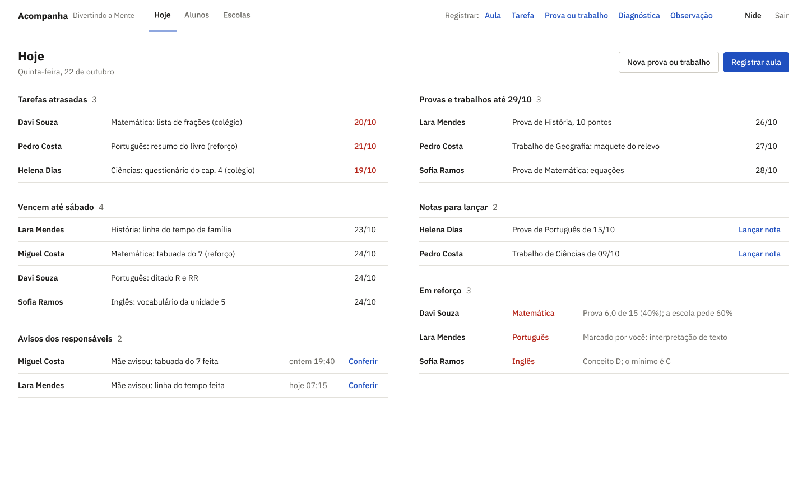

# Template padrão da aplicação

Pré-requisitos: <a href="02-Especificacao.md"> Especificação do projeto</a>, <a href="03-Metodologia.md"> Metodologia</a>, <a href="05-Projeto-interface.md"> Projeto de interface</a>

Esta seção define o layout padrão usado em todas as telas do Acompanha: identidade visual, cores, tipografia, componentes e responsividade. Os valores foram tirados do [protótipo no Figma](https://www.figma.com/design/KjtSsah133BDvt0Nvc8JpL/Acompanha---Prot%C3%B3tipo?node-id=11-709).

A identidade visual segue a mesma ideia do restante do projeto: o sistema precisa ser simples para quem tem pouco tempo (as professoras) e para quem tem pouca familiaridade com tecnologia (os responsáveis). Por isso o visual é sóbrio, com fundo branco, texto escuro, uma única cor de destaque e cores de alerta usadas só quando pedem atenção.

## Marca

O Acompanha usa um logotipo só de texto (*wordmark*): o nome **Acompanha** em IBM Plex Sans Bold, na cor do texto principal, seguido do nome da escolinha, **Divertindo a Mente**, em IBM Plex Sans Regular, na cor do texto secundário. O conjunto fica no canto esquerdo do topo de todas as telas da professora.

O nome descreve o que o sistema faz: acompanhar o aluno, aula a aula, e deixar esse acompanhamento visível para a professora e para a família. Colocar o nome da escolinha ao lado deixa claro que o sistema é dela, e não um produto genérico.

Regras de uso:

- Usar sempre sobre fundo branco.
- Não aplicar a cor de destaque nem as cores de alerta ao logotipo.
- Não trocar a fonte nem distorcer o texto.

## Cores

| Uso | Cor | Hexadecimal |
| --- | --- | --- |
| Destaque: botão primário, links, aba ativa | Azul | `#1F4FBF` |
| Destaque ao passar o mouse | Azul escuro | `#183E96` |
| Texto principal | Quase preto | `#1C1B19` |
| Texto secundário: datas, descrições, contadores | Cinza | `#6A6862` |
| Linhas divisórias | Cinza claro | `#E3E1DB` |
| Borda de campos e botões secundários | Cinza médio | `#CFCCC4` |
| Fundo | Branco | `#FFFFFF` |
| Atenção: atraso, reforço, "Precisa de atenção", ações de perigo | Vermelho | `#B42318` |
| Fundo do botão de perigo ao passar o mouse | Vermelho claro | `#FEF3F2` |
| Situação positiva: "Em dia", "Dentro do esperado" | Verde | `#2B7A3B` |

O vermelho e o verde nunca aparecem sozinhos: a cor sempre acompanha um texto ("Atrasada", "Em dia", "Precisa de atenção"), para que a informação não dependa só da cor.

## Tipografia

A fonte é a [IBM Plex Sans](https://fonts.google.com/specimen/IBM+Plex+Sans), gratuita e disponível no Google Fonts, com altura de linha de 1,45 em todos os textos.

| Elemento | Desktop (professora) | Celular (responsável) | Peso |
| --- | --- | --- | --- |
| Título da tela | 22 px | 22 px | Bold |
| Título de seção | 15 px | 17 px | SemiBold |
| Texto | 14 px | 16 px | Regular |
| Nome do aluno, botões, rótulos de situação | 14 px | 16 px | Medium ou SemiBold |
| Logotipo: "Acompanha" e "Divertindo a Mente" | 16 px e 13 px | — | Bold e Regular |

No celular os textos são maiores, para facilitar a leitura de quem consulta pelo telefone.

## Componentes

- **Botões:** cantos arredondados de 4 px, texto de 14 px em Medium e espaçamento interno de 8 px na vertical e 14 px na horizontal. Há três tipos:
  - **Primário:** fundo azul e texto branco, para a ação principal da tela (por exemplo, Registrar aula ou Salvar).
  - **Secundário:** fundo branco, borda cinza e texto escuro, para ações alternativas.
  - **Perigo:** fundo branco, borda cinza e texto vermelho, para ações que não podem ser desfeitas, como encerrar matrícula.
- **Listas:** cada item é uma linha separada por uma divisória cinza clara, sem cartões nem sombras.
- **Seções:** título em SemiBold com um contador em cinza ao lado (por exemplo, "Tarefas atrasadas 3").
- **Topo da professora:** logotipo, abas Hoje, Alunos e Escolas (a aba ativa fica sublinhada em azul), atalhos de registro e o nome da professora com o link Sair.

## Iconografia

O protótipo não usa ícones. As ações aparecem como texto ("Lançar nota", "Conferir", "Ver relatório de outubro"), para que ninguém precise adivinhar o que um ícone significa.

## Responsividade

Cada frente foi desenhada para o equipamento do seu público (R03):

- **Professora:** computador, com tela de referência de 1440 px de largura e conteúdo em até duas colunas.
- **Responsável:** celular, com tela de referência de 360 px de largura, uma coluna só e margens laterais de 16 px.

## Tela de exemplo

O painel Hoje (D01) mostra o template aplicado: o topo da professora, o título da tela, os botões primário e secundário, as listas separadas por divisórias e o vermelho usado só nas datas vencidas e nas matérias em reforço.

