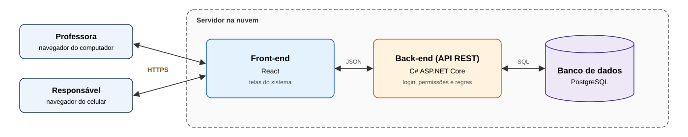
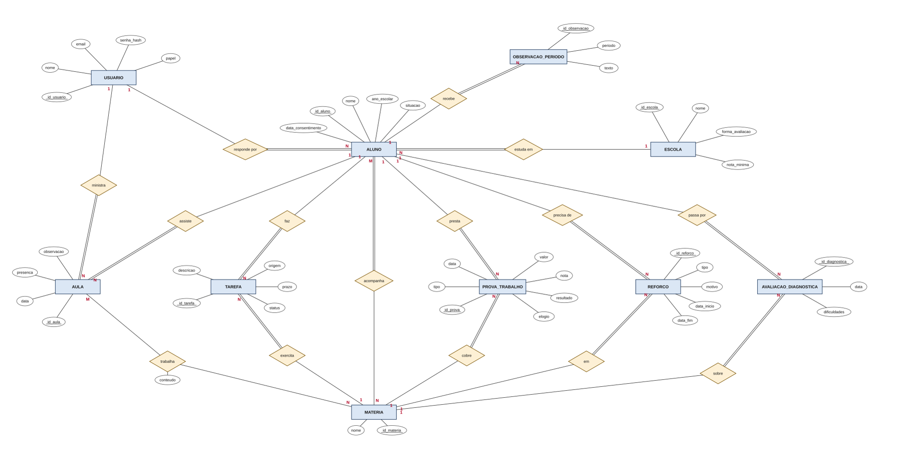

# Arquitetura da solução

Pré-requisitos: <a href="05-Projeto-interface.md"> Projeto de interface</a>

O Acompanha é uma aplicação web em três camadas: front-end em React, back-end (API REST) em C# com ASP.NET Core e banco de dados PostgreSQL. A professora e o responsável usam o sistema pelo navegador, sem instalar nada.

## Funções do sistema

- **Acesso:** login da professora e do responsável; cada um só vê o que o seu papel permite.
- **Cadastros:** alunos, responsáveis, escolas (com a forma de avaliação) e matérias.
- **Registros da professora:** aulas, tarefas, provas e trabalhos com nota, avaliações diagnósticas e observação do período.
- **Reforço automático:** quando uma nota fica abaixo do esperado pela escola, o aluno entra em reforço na matéria.
- **Consultas da professora:** painel de pendências e histórico do aluno.
- **Consultas do responsável:** semana do filho e relatório de progresso.

## Como o sistema executa as funções

1. O usuário usa as telas do front-end React no navegador.
2. O front-end chama a API por HTTPS e recebe os dados em JSON.
3. A API confere o login e o papel. O responsável só recebe dados dos próprios filhos, e essa checagem é feita na API, não na tela.
4. A API aplica as regras de negócio (por exemplo, comparar a nota com o esperado pela escola) e lê ou grava no PostgreSQL.
5. A API devolve a resposta e o front-end mostra o resultado.

## Diagrama de classes

O diagrama de classes ilustra graficamente a estrutura do software e como cada uma das classes estará interligada. Essas classes servem de modelo para materializar os objetos que serão executados na memória.

Elabore o diagrama de classes utilizando uma ferramenta de modelagem apropriada.

> **Links úteis**:
> - [Diagramas de classes - documentação da IBM](https://www.ibm.com/docs/pt-br/rational-soft-arch/9.7.0?topic=diagrams-class)
> - [O que é um diagrama de classe UML?](https://www.lucidchart.com/pages/pt/o-que-e-diagrama-de-classe-uml)

##  Modelo de dados

Um único modelo de dados atende os dois processos mapeados: [provas e trabalhos do colégio](processes/processo-1-to-be.md) e [consulta do progresso pelo responsável](processes/processo-2-to-be.md).

### Modelo conceitual 

Diagrama Entidade-Relacionamento (DER) em notação Peter Chen. O arquivo [der-acompanha.drawio.svg](images/der-acompanha.drawio.svg) pode ser editado no [draw.io](https://app.diagrams.net).

- **USUARIO** é quem entra no sistema. O atributo `papel` diz se é professora ou responsável e define o que cada um pode acessar.
- **ALUNO** é o centro do modelo: tem um responsável, estuda em uma escola e acompanha várias matérias.
- **AULA, TAREFA, PROVA_TRABALHO, REFORCO e AVALIACAO_DIAGNOSTICA** são os registros do aluno, cada um ligado a uma matéria.
- **OBSERVACAO_PERIODO** é o texto da professora que aparece no relatório do responsável.

> **Links úteis**:
> - [Notação de Peter Chen para modelagem conceitual de banco de dados](https://www.youtube.com/watch?v=_y31cFi_ByY)
> - [Como fazer um diagrama entidade-relacionamento](https://www.lucidchart.com/pages/pt/como-fazer-um-diagrama-entidade-relacionamento)

### Modelo relacional

Modelo lógico derivado do DER. **PK** é chave primária, **FK** é chave estrangeira e **UK** é valor único. Os relacionamentos M:N (*acompanha* e *trabalha*) viram as tabelas `aluno_materia` e `aula_materia`.

> **Links úteis**:
> - [Criando um modelo relacional - documentação da IBM](https://www.ibm.com/docs/pt-br/cognos-analytics/12.0.0?topic=designer-creating-relational-model)
> - [Como fazer um modelo relacional](https://www.youtube.com/watch?v=DWWIREUkxOI)

## Tecnologias

| **Dimensão** | **Tecnologia** |
| --- | --- |
| Front-end | React |
| Back-end | C# com ASP.NET Core Web API |
| Acesso a dados | Entity Framework Core |
| SGBD | PostgreSQL |
| Versionamento | Git + GitHub |
| Protótipo | Figma |

## Hospedagem

| **Camada** | **Serviço** |
| --- | --- |
| Front-end (React) | [Vercel](https://vercel.com), plano gratuito |
| API (C# com ASP.NET Core) | [Render](https://render.com), plano gratuito, em contêiner Docker |
| Banco de dados (PostgreSQL) | [Neon](https://neon.com), plano gratuito |
| Monitor de disponibilidade | [UptimeRobot](https://uptimerobot.com), plano gratuito |

Todos os serviços estão no plano gratuito, o que atende ao custo zero exigido pelo R02, durante e depois da disciplina.

- O front-end é publicado na Vercel como site estático e chama a API por HTTPS (RNF06).
- No plano gratuito do Render, a API hiberna depois de 15 minutos sem requisições. Para atender ao RNF04 (sem hibernar e sem partida a frio longa), o UptimeRobot chama um endpoint de saúde da API a cada 5 minutos. As horas gratuitas do Render cobrem um serviço ligado o mês inteiro.
- O mesmo monitor mede a disponibilidade mensal exigida pelo RNF04.
- O Neon suspende o banco quando ele fica sem uso e o religa sozinho na próxima conexão, em menos de 1 segundo, o que fica dentro do limite de partida a frio do RNF04. O endpoint de saúde chamado pelo monitor não consulta o banco, para não gastar as horas de processamento gratuitas do Neon.
- O backup diário do RNF09 é feito por uma rotina agendada (GitHub Actions) que gera um `pg_dump` criptografado e o guarda por 7 dias.

## Qualidade de software

Conceituar qualidade é uma tarefa complexa, mas ela pode ser vista como um método gerencial que, por meio de procedimentos disseminados por toda a organização, busca garantir um produto final que satisfaça às expectativas dos stakeholders.

No contexto do desenvolvimento de software, qualidade pode ser entendida como um conjunto de características a serem atendidas, de modo que o produto de software atenda às necessidades de seus usuários. Entretanto, esse nível de satisfação nem sempre é alcançado de forma espontânea, devendo ser continuamente construído. Assim, a qualidade do produto depende fortemente do seu respectivo processo de desenvolvimento.

A norma internacional ISO/IEC 25010, que é uma atualização da ISO/IEC 9126, define oito características de qualidade para produtos de software, cada uma dividida em subcaracterísticas. O grupo escolheu as subcaracterísticas que mais pesam para os dois públicos do Acompanha: professoras com pouco tempo e responsáveis que consultam pelo celular, lidando com dados de crianças. Cada uma está ligada a um requisito não funcional da <a href="02-Especificacao.md#requisitos-não-funcionais">Especificação</a>, que já traz o critério de medição.

| **Característica** | **Subcaracterística** | **Justificativa** | **Métrica** | **Meta** |
| --- | --- | --- | --- | --- |
| Usabilidade | Operabilidade | A rotina das professoras é corrida; se registrar uma aula der trabalho, o registro deixa de ser feito, como aconteceu com a planilha (RNF01). | Tempo para registrar uma aula, medido com as professoras | Até 1 minuto, em uma única tela |
| Usabilidade | Apreensibilidade | Os responsáveis têm de 3 a 5 de facilidade com tecnologia e não recebem treinamento. | Percentual de responsáveis que encontram a situação do filho por matéria sem ajuda, no primeiro acesso | 100% dos responsáveis testados |
| Usabilidade | Acessibilidade | A consulta é feita no celular, por pessoas de idades variadas (RNF11). | Tamanho mínimo de texto e contraste nas telas do responsável | Texto ≥ 16 px; contraste nível AA das WCAG 2.1 |
| Eficiência de desempenho | Comportamento em relação ao tempo | O painel e o relatório são as telas mais usadas e precisam abrir rápido (RNF03). | Percentual de requisições do painel, do histórico e do relatório respondidas em até 2 s, com 30 alunos e 1 ano de registros | ≥ 95% |
| Confiabilidade | Disponibilidade | Se o sistema estiver fora do ar no horário da escolinha, a professora volta a anotar de memória (RNF04). | Tempo no ar no horário de funcionamento, medido por monitor externo | ≥ 99% ao mês |
| Confiabilidade | Recuperabilidade | Perder os registros apagaria o histórico dos alunos (RNF09). | Testes de restauração do backup bem-sucedidos | Pelo menos 1 antes da entrega |
| Segurança | Confidencialidade | Os dados são de crianças, e o responsável só pode ver os próprios filhos (RNF07, LGPD art. 14). | Percentual de endpoints com dados de aluno cobertos pelo teste automatizado de autorização por vínculo | 100% |
| Segurança | Autenticidade | Só quem tem login pode acessar, e a senha não pode vazar (RNF05 e RNF06). | Senhas guardadas com hash e salt; páginas servidas por HTTPS | 100% das senhas e 100% das páginas |
| Segurança | Responsabilização | É preciso saber quem acessou ou alterou os dados de um aluno (RNF08). | Percentual de acessos e alterações em dados de aluno com registro de quem, quando e o quê | 100%, guardados por 6 meses |

> **Links úteis**:
> - [ISO/IEC 25010:2011 - Systems and Software Engineering — Systems and Software Quality Requirements and Evaluation (SQuaRE) — System and Software Quality Models](https://www.iso.org/standard/35733.html/)
> - [Análise sobre a ISO 9126 – NBR 13596](https://www.tiespecialistas.com.br/analise-sobre-iso-9126-nbr-13596/)
> - [Qualidade de software - Engenharia de Software](https://www.devmedia.com.br/qualidade-de-software-engenharia-de-software-29/18209)
