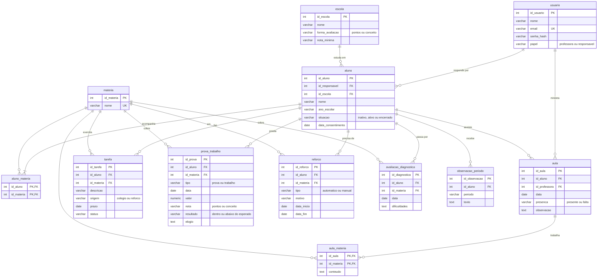

# Arquitetura da solução

<span style="color:red">Pré-requisitos: <a href="05-Projeto-interface.md"> Projeto de interface</a></span>

O Acompanha é uma aplicação web em três camadas: front-end em React, back-end (API REST) em C# com ASP.NET Core e banco de dados PostgreSQL. A professora e o responsável usam o sistema pelo navegador, sem instalar nada.


## Funções do sistema

- **Acesso:** login da professora e do responsável; cada um só vê o que o seu papel permite.
- **Cadastros:** alunos, responsáveis, escolas (com a forma de avaliação) e matérias.
- **Registros da professora:** aulas, tarefas, provas e trabalhos com nota, avaliações diagnósticas e observação do período.
- **Reforço automático:** quando uma nota fica abaixo do esperado pela escola, o aluno entra em reforço na matéria.
- **Consultas da professora:** painel de pendências e histórico do aluno.
- **Consultas do responsável:** semana do filho e relatório de progresso.

## Como o sistema executa as funções

1. O usuário usa as telas do front-end React no navegador.
2. O front-end chama a API por HTTPS e recebe os dados em JSON.
3. A API confere o login e o papel. O responsável só recebe dados dos próprios filhos, e essa checagem é feita na API, não na tela.
4. A API aplica as regras de negócio (por exemplo, comparar a nota com o esperado pela escola) e lê ou grava no PostgreSQL.
5. A API devolve a resposta e o front-end mostra o resultado.

## Diagrama de classes

O diagrama de classes ilustra graficamente a estrutura do software e como cada uma das classes estará interligada. Essas classes servem de modelo para materializar os objetos que serão executados na memória.

Elabore o diagrama de classes utilizando uma ferramenta de modelagem apropriada.

> **Links úteis**:
> - [Diagramas de classes - documentação da IBM](https://www.ibm.com/docs/pt-br/rational-soft-arch/9.7.0?topic=diagrams-class)
> - [O que é um diagrama de classe UML?](https://www.lucidchart.com/pages/pt/o-que-e-diagrama-de-classe-uml)

##  Modelo de dados

Um único modelo de dados atende os dois processos mapeados: [provas e trabalhos do colégio](processes/processo-1-to-be.md) e [consulta do progresso pelo responsável](processes/processo-2-to-be.md).

### Modelo conceitual 

Diagrama Entidade-Relacionamento (DER) em notação Peter Chen. O arquivo [der-acompanha.drawio.svg](images/der-acompanha.drawio.svg) pode ser editado no [draw.io](https://app.diagrams.net).


- **USUARIO** é quem entra no sistema. O atributo `papel` diz se é professora ou responsável e define o que cada um pode acessar.
- **ALUNO** é o centro do modelo: tem um responsável, estuda em uma escola e acompanha várias matérias.
- **AULA, TAREFA, PROVA_TRABALHO, REFORCO e AVALIACAO_DIAGNOSTICA** são os registros do aluno, cada um ligado a uma matéria.
- **OBSERVACAO_PERIODO** é o texto da professora que aparece no relatório do responsável.

> **Links úteis**:
> - [Notação de Peter Chen para modelagem conceitual de banco de dados](https://www.youtube.com/watch?v=_y31cFi_ByY)
> - [Como fazer um diagrama entidade-relacionamento](https://www.lucidchart.com/pages/pt/como-fazer-um-diagrama-entidade-relacionamento)

### Modelo relacional

Modelo lógico derivado do DER. **PK** é chave primária, **FK** é chave estrangeira e **UK** é valor único. Os relacionamentos M:N (*acompanha* e *trabalha*) viram as tabelas `aluno_materia` e `aula_materia`.



> **Links úteis**:
> - [Criando um modelo relacional - documentação da IBM](https://www.ibm.com/docs/pt-br/cognos-analytics/12.0.0?topic=designer-creating-relational-model)
> - [Como fazer um modelo relacional](https://www.youtube.com/watch?v=DWWIREUkxOI)


### Modelo físico

Insira aqui o script de criação das tabelas do banco de dados.

Veja um exemplo:

```sql
CREATE TABLE employees (
    emp_no      INT             NOT NULL,
    birth_date  DATE            NOT NULL,
    first_name  VARCHAR(14)     NOT NULL,
    last_name   VARCHAR(16)     NOT NULL,
    gender      ENUM ('M','F')  NOT NULL,    
    hire_date   DATE            NOT NULL,
    PRIMARY KEY (emp_no)
);

CREATE TABLE departments (
    dept_no     CHAR(4)         NOT NULL,
    dept_name   VARCHAR(40)     NOT NULL,
    PRIMARY KEY (dept_no),
    UNIQUE  KEY (dept_name)
);

CREATE TABLE dept_manager (
   emp_no       INT             NOT NULL,
   dept_no      CHAR(4)         NOT NULL,
   from_date    DATE            NOT NULL,
   to_date      DATE            NOT NULL,
   FOREIGN KEY (emp_no)  REFERENCES employees (emp_no)    ON DELETE CASCADE,
   FOREIGN KEY (dept_no) REFERENCES departments (dept_no) ON DELETE CASCADE,
   PRIMARY KEY (emp_no,dept_no)
); 

CREATE TABLE dept_emp (
    emp_no      INT             NOT NULL,
    dept_no     CHAR(4)         NOT NULL,
    from_date   DATE            NOT NULL,
    to_date     DATE            NOT NULL,
    FOREIGN KEY (emp_no)  REFERENCES employees   (emp_no)  ON DELETE CASCADE,
    FOREIGN KEY (dept_no) REFERENCES departments (dept_no) ON DELETE CASCADE,
    PRIMARY KEY (emp_no,dept_no)
);

CREATE TABLE titles (
    emp_no      INT             NOT NULL,
    title       VARCHAR(50)     NOT NULL,
    from_date   DATE            NOT NULL,
    to_date     DATE,
    FOREIGN KEY (emp_no) REFERENCES employees (emp_no) ON DELETE CASCADE,
    PRIMARY KEY (emp_no,title, from_date)
); 

CREATE TABLE salaries (
    emp_no      INT             NOT NULL,
    salary      INT             NOT NULL,
    from_date   DATE            NOT NULL,
    to_date     DATE            NOT NULL,
    FOREIGN KEY (emp_no) REFERENCES employees (emp_no) ON DELETE CASCADE,
    PRIMARY KEY (emp_no, from_date)
); 

CREATE OR REPLACE VIEW dept_emp_latest_date AS
    SELECT emp_no, MAX(from_date) AS from_date, MAX(to_date) AS to_date
    FROM dept_emp
    GROUP BY emp_no;

-- Shows only the current department for each employee
CREATE OR REPLACE VIEW current_dept_emp AS
    SELECT l.emp_no, dept_no, l.from_date, l.to_date
    FROM dept_emp d
        INNER JOIN dept_emp_latest_date l
        ON d.emp_no=l.emp_no AND d.from_date=l.from_date AND l.to_date = d.to_date;
```
Esse script deverá ser incluído em um arquivo .sql na pasta [de scripts SQL](../src/db).


## Tecnologias

| **Dimensão** | **Tecnologia** |
| --- | --- |
| Front-end | React |
| Back-end | C# com ASP.NET Core Web API |
| Acesso a dados | Entity Framework Core |
| SGBD | PostgreSQL |
| Versionamento | Git + GitHub |
| Protótipo | Figma |

## Hospedagem

A definir pelo grupo. A hospedagem precisa ter custo zero (R02) e não pode hibernar (RNF04).

## Qualidade de software

Conceituar qualidade é uma tarefa complexa, mas ela pode ser vista como um método gerencial que, por meio de procedimentos disseminados por toda a organização, busca garantir um produto final que satisfaça às expectativas dos stakeholders.

No contexto do desenvolvimento de software, qualidade pode ser entendida como um conjunto de características a serem atendidas, de modo que o produto de software atenda às necessidades de seus usuários. Entretanto, esse nível de satisfação nem sempre é alcançado de forma espontânea, devendo ser continuamente construído. Assim, a qualidade do produto depende fortemente do seu respectivo processo de desenvolvimento.

A norma internacional ISO/IEC 25010, que é uma atualização da ISO/IEC 9126, define oito características e 30 subcaracterísticas de qualidade para produtos de software. Com base nessas características e nas respectivas subcaracterísticas, identifique as subcaracterísticas que sua equipe utilizará como base para nortear o desenvolvimento do projeto de software, considerando alguns aspectos simples de qualidade. Justifique as subcaracterísticas escolhidas pelo time e elenque as métricas que permitirão à equipe avaliar os objetos de interesse.

> **Links úteis**:
> - [ISO/IEC 25010:2011 - Systems and Software Engineering — Systems and Software Quality Requirements and Evaluation (SQuaRE) — System and Software Quality Models](https://www.iso.org/standard/35733.html/)
> - [Análise sobre a ISO 9126 – NBR 13596](https://www.tiespecialistas.com.br/analise-sobre-iso-9126-nbr-13596/)
> - [Qualidade de software - Engenharia de Software](https://www.devmedia.com.br/qualidade-de-software-engenharia-de-software-29/18209)
